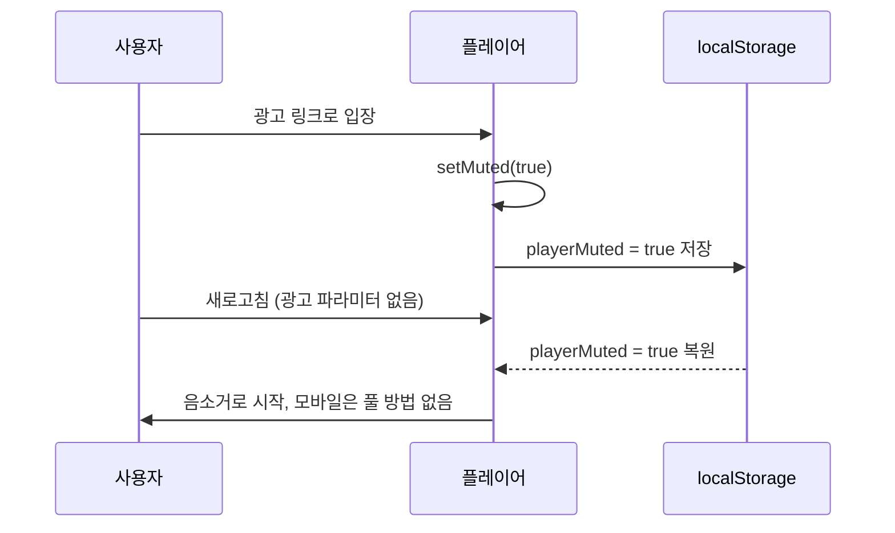

## TL;DR

- 회사 업무 하나를 두고 AI 없이 내가 짠 코드와 Claude Code가 짠 코드를 같은 테스트 케이스로 비교했다.
- 기능은 "광고로 유입되면 자동재생이 되도록 음소거로 영상을 시작한다"였다. 나는 약 20줄을 1시간 동안 짰고, Claude Code는 약 50줄을 10분 정도에 짰다.
- 내 코드는 기존 음소거 함수를 재사용했는데, 그 함수가 음소거 값을 localStorage에 저장하고 있었다. 새로고침하면 저장된 값 때문에 계속 음소거로 시작했고, 볼륨 조절 UI가 없는 모바일 웹에서는 소리를 켤 방법이 없었다.
- Claude Code는 `isAdLandingMuted`라는 상태를 새로 만들고, 이 경우에는 저장 없이 음소거만 걸었다. 최종적으로 AI 코드를 썼다.

## 광고 유입 시 왜 음소거로 자동재생해야 하나요?

브라우저는 소리가 나는 영상의 자동재생을 막고, 음소거된 영상의 자동재생은 허용하기 때문이다. Chrome과 Safari 모두 사용자가 페이지와 상호작용하기 전에는 소리 있는 `play()`를 거부하거나 일시정지 상태로 둔다.

광고를 눌러 들어온 사용자는 첫 화면에서 바로 영상이 움직여야 이탈하지 않는다. 그래서 광고 유입일 때만 음소거로 시작해 자동재생 정책을 통과시키는 기능을 넣기로 했다.

요구사항은 단순했다.

- 광고로 유입되면 음소거 상태로 영상을 자동재생한다.
- 광고 유입이 아닐 때의 기존 동작(사용자가 마지막으로 고른 음소거 상태 복원)은 그대로 둔다.

## AI와 코딩 대결은 어떻게 했나요?

같은 요구사항을 나는 AI 없이 직접 짜고, 별도로 Claude Code에게도 짜게 한 뒤 같은 테스트 케이스를 통과하는지로 비교했다. 시간은 제대로 재지 못했지만 체감으로 나는 1시간, Claude Code는 10분 정도였다.

| 항목 | 나 (AI 없이) | Claude Code |
| --- | --- | --- |
| 바뀐 코드 줄 수 | 약 20줄 | 약 50줄 |
| 걸린 시간(체감) | 약 1시간 | 약 10분 |
| 테스트 케이스 | 새로고침 시나리오에서 실패 | 통과 |
| 최종 채택 | - | 채택 |

줄 수만 보면 내 코드가 더 간결했다. 결과를 보기 전까지는 내가 이겼다고 생각했다.

## 음소거 값이 localStorage에 남아 새로고침 후에도 음소거가 풀리지 않은 이유는?

내가 재사용한 기존 음소거 함수가 음소거 상태를 localStorage에 저장하고 있었기 때문이다. 광고 유입 때 이 함수로 음소거를 걸자 "사용자가 직접 음소거를 골랐다"는 값이 함께 저장됐고, 새로고침하면 플레이어가 그 값을 복원해 광고 유입이 아닌데도 음소거로 시작했다.

이 저장 로직은 원래 의도가 있었다. 사용자가 다른 화면에서 음소거를 하고 들어오면 다음 영상도 음소거로 시작해야 한다. 그래서 음소거 함수는 값을 바꿀 때마다 저장했고, 나는 그 사실을 모르고 함수를 불렀다.

아래는 구조만 남긴 예시 코드다(실제 서비스 코드가 아니다).

```js
const video = document.querySelector('video');
const STORAGE_KEY = 'playerMuted';

function isAdLanding() {
  return new URLSearchParams(location.search).has('ad');
}

// 기존 함수: 사용자가 음소거 버튼을 누를 때 쓰던 함수
function setMuted(muted) {
  video.muted = muted;
  localStorage.setItem(STORAGE_KEY, String(muted)); // 다음 입장 때 복원하려고 저장
}

function initPlayer() {
  setMuted(localStorage.getItem(STORAGE_KEY) === 'true'); // 저장된 값 복원
  if (isAdLanding()) {
    setMuted(true); // 내가 추가한 부분: 저장까지 같이 일어난다
  }
  video.play();
}
```

흐름을 그리면 이렇다.



PC에서는 볼륨 버튼으로 풀면 되니 크게 티가 나지 않는다. 문제는 모바일 웹이다. 이 플레이어의 모바일 웹 화면에는 볼륨 조절 UI가 없어서, 저장된 음소거 값으로 시작하면 사용자가 소리를 켤 방법이 없었다.

## Claude Code는 음소거 부작용을 어떻게 피했나요?

Claude Code는 기존 음소거 값을 건드리지 않고 `isAdLandingMuted`라는 상태를 새로 만들었다. 광고 유입으로 거는 음소거는 이 값으로만 표시하고 localStorage에는 저장하지 않으니, 새로고침하면 광고 때문에 걸린 음소거는 자연스럽게 사라진다.

```js
let isAdLandingMuted = false;

// 광고 유입 전용: 화면만 음소거하고 저장하지 않는다
function muteForAdLanding() {
  isAdLandingMuted = true;
  video.muted = true;
}

function initPlayer() {
  setMuted(localStorage.getItem(STORAGE_KEY) === 'true'); // 기존 동작 그대로
  if (isAdLanding()) {
    muteForAdLanding();
  }
  video.play();
}
```

핵심은 음소거를 두 종류로 나눈 것이다.

- 사용자 설정 음소거(user preference): 사용자가 직접 고른 값이다. 다음 입장 때도 유지되어야 하니 저장한다.
- 정책 음소거(policy mute): 자동재생 정책을 통과하려고 시스템이 잠깐 거는 값이다. 이번 입장에만 의미가 있으니 저장하지 않는다.

내 코드는 이 두 가지를 하나의 함수로 처리해서 정책 음소거가 사용자 설정처럼 저장됐다. AI는 줄 수가 늘어나는 대신 두 상태를 분리했고, 그래서 기존 동작에 부작용(side effect)이 없었다.

## 검토한 대안

### 1안: 기존 `setMuted()` 재사용 (버림)

내가 처음 짠 방식이다. 코드는 가장 짧지만, 함수 안에 숨은 저장 동작까지 같이 실행된다. 새로고침 테스트에서 실패했다.

### 2안: 광고 유입 후 저장된 값을 되돌리기 (생각만 해 봄)

광고 음소거를 건 뒤 localStorage 값을 원래대로 돌려놓거나, 페이지를 떠날 때 지우는 방식도 생각해 볼 수 있다. 하지만 "저장했다가 지운다"는 순서에 기대게 되고, 사용자가 광고 페이지에서 직접 음소거를 누른 경우까지 지워 버릴 수 있다. 문제를 덮는 방식이라 고르지 않았다.

### 3안: 저장하지 않는 별도 상태 `isAdLandingMuted` (채택)

Claude Code가 짠 방식이다. 기존 음소거 함수와 저장 로직은 한 줄도 바꾸지 않고, 광고 유입 전용 경로를 새로 만들었다. 줄 수는 2.5배였지만 기존 기능에 영향을 주지 않았다.

## 결과 / 회고

최종적으로 Claude Code가 짠 코드를 썼다. 1시간 걸려 짠 20줄이 10분 걸린 50줄에 진 셈이다.

돌아보면 나는 "코드를 적게 바꾸는 것"을 좋은 코드라고 여겼다. 기존 함수를 재사용하면 줄 수가 줄어든다. 하지만 재사용한 함수가 무엇을 하는지 끝까지 확인하지 않으면, 줄 수를 줄인 만큼 모르는 동작이 따라 들어온다. 이번에는 그게 localStorage 저장이었다.

AI는 기존 값을 재활용하기보다 새 값을 하나 더 파서 그 값만 조정했다. 처음엔 장황해 보였는데, 결과적으로 기존 코드를 건드리지 않는 쪽이 더 안전했다.

솔직히 충격이 컸다. 이제는 AI로만 코드를 짜려고 한다. AI와 일하면서 하루를 쓰는 방식이 어떻게 바뀌었는지는 [AI로 일하니 모든 일이 딥워크가 됐다](/posts/ai-deepwork-block-schedule)에 적었다. 앞으로 내 일은 직접 타이핑하는 것보다 요구사항과 테스트 케이스를 정확히 정하는 쪽으로 옮겨 갈 것 같다. AI가 짠 테스트도 사람이 다시 봐야 한다는 이야기는 [AI가 짠 Playwright 검수 자동화, 첫 FAIL 11건은 테스트가 틀린 거였다](/posts/ai-playwright-qa-automation)에 정리했다.

## 참고

- [Autoplay policy in Chrome](https://developer.chrome.com/blog/autoplay)
- [Autoplay guide for media and Web Audio APIs - MDN](https://developer.mozilla.org/en-US/docs/Web/Media/Guides/Autoplay)
- [Window: localStorage property - MDN](https://developer.mozilla.org/en-US/docs/Web/API/Window/localStorage)
- [HTMLMediaElement: muted property - MDN](https://developer.mozilla.org/en-US/docs/Web/API/HTMLMediaElement/muted)
