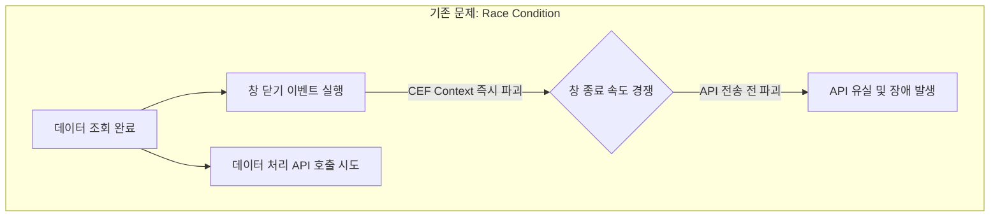
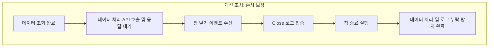

## TL;DR

- 데이터 조회와 처리를 두 단계 API로 나누고, 조회가 끝나면 모달을 먼저 닫은 뒤 처리 API를 백그라운드로 호출하도록 바꿨다.
- 데스크톱 클라이언트(CEF)에서는 창이 닫히는 순간 JS 컨텍스트와 진행 중인 네트워크 요청이 함께 사라진다. 그래서 처리 요청이 **전송되기도 전에** 창이 닫히는 경우가 생겼다.
- 로컬과 QA 환경에서는 요청이 먼저 나가는 타이밍이 우연히 맞아 재현되지 않았다. 해결은 단순했다. **처리 API 응답을 받은 뒤에 창을 닫도록** 순서를 강제했다.

## 상황: 배포 당일, 간헐적으로 사라지는 요청

신규 기능을 배포한 당일, 트래픽이 몰리는 특정 상황에서 데이터 처리 요청이 간헐적으로 누락됐다. 항상 실패하는 게 아니라 "가끔" 실패했다는 점이 이 장애의 핵심이었다.

<!-- 수치 보강: 누락 건수나 비율, 장애 인지부터 조치까지 걸린 시간이 있다면 여기에 넣으면 좋다 -->

## 배경: 왜 모달을 먼저 닫았나

기존에는 하나의 API가 데이터 조회와 처리를 모두 맡고 있었다. 처리 시간이 길어 API 세션을 오래 점유하는 문제가 있었고, 그동안 사용자는 모달 앞에서 기다려야 했다.

그래서 구조를 두 단계로 나눴다.

1. **조회 API**: 필요한 데이터를 가져온다.
2. **처리 API**: 가져온 데이터를 처리한다.

그리고 사용자 대기 시간을 줄이기 위해, 1단계 조회가 끝나면 모달을 바로 닫고 2단계 처리 API는 백그라운드에서 실행되도록 했다. 일반 브라우저 탭이었다면 크게 문제 되지 않았을 설계다.



## 원인: 창이 닫히면 요청도 함께 사라진다

이 화면은 일반 브라우저가 아니라 데스크톱 클라이언트에 내장된 CEF(Chromium Embedded Framework) 창에서 동작한다. CEF에서 창 닫기 이벤트를 받으면 해당 브라우저 프로세스와 JS 컨텍스트가 즉시 정리된다. 아직 전송되지 않았거나 진행 중인 네트워크 요청도 예외가 아니다.

즉, "창 닫기"와 "처리 API 전송"이 서로 경쟁하는 구조였다.

- 처리 요청이 먼저 나가면 → 정상 처리
- 창이 먼저 닫히면 → 요청 자체가 유실

데이터가 크거나 네트워크가 느려 요청 전송이 조금만 늦어져도 창이 먼저 닫혔다. 배포 당일 트래픽이 몰리면서 이 경쟁에서 지는 경우가 늘어난 것이다.

## 왜 QA에서는 보이지 않았나

로컬과 QA 환경에서는 요청 패킷이 전송된 직후에 창 파괴 루틴이 실행됐다. 코드가 올바르게 동작해서가 아니라, **타이밍이 우연히 맞았기 때문에** 정상으로 보였던 것이다.

Race Condition은 실행 환경의 네트워크 속도와 기기 성능에 따라 결과가 달라진다. 빠르고 한산한 테스트 환경 한 곳에서 통과했다고 해서 실제 사용자 환경에서도 안전하다는 보장은 없다.

## 검토한 대안

### 1안: 부모 창에 API 호출을 위임한다 (버림)

모달이 닫혀도 살아 있는 부모 창의 컨텍스트로 처리 API 호출을 옮기면, 모달을 먼저 닫는 UX를 유지하면서도 요청을 지킬 수 있다. 기술적으로는 가장 깔끔해 보였다.

하지만 두 가지 이유로 철회했다.

- **레거시 시스템과의 스펙 일치**: 기존 시스템의 동작 방식과 맞춰야 했다.
- **사용자의 취소 의도 반영**: 사용자가 빠르게 창을 닫는 행동에는 "처리를 취소하겠다"는 의도가 담겨 있을 수 있다. 부모 창이 무조건 처리를 이어가면 이 의도를 무시하게 된다.

<!-- 보강: sendBeacon이나 fetch keepalive처럼 창이 닫혀도 전송을 이어가는 방식을 검토했다면, 왜 쓰지 않았는지 한두 문장 추가하면 좋다 -->

### 최종안: 처리 API 응답을 받은 뒤에 창을 닫는다

모달 본창에서 처리 API의 응답을 끝까지 기다린 다음 창 닫기를 실행하도록 순서를 강제했다.

```typescript
// 수정 전: 조회 직후 창을 닫아 처리 요청이 유실될 수 있음
async function handleProcessDataWrong() {
  const data = await fetchData();
  // 창이 닫히면서 CEF 렌더러가 정리되어 processData가 전송되지 못할 수 있음
  closeWindow();
  await processData(data);
}

// 수정 후: 처리 완료를 보장한 뒤 종료 로그를 남기고 창을 닫음
async function handleProcessDataFixed() {
  try {
    const data = await fetchData();
    await processData(data);
  } catch (error) {
    console.error('처리 실패', error);
  } finally {
    await sendLoggingEvent('MODAL_CLOSE');
    closeWindow();
  }
}
```

닫기 로그도 같은 문제를 겪고 있었다. 사용자가 닫기 버튼을 누른 시점의 이탈 로그가 창이 닫히면서 함께 사라졌다. 그래서 창 닫기 이벤트를 받는 시점에 close 로그를 먼저 전송하고, 그다음 창을 닫도록 묶었다.



## 트레이드오프

이 해결책은 처음 구조를 바꾼 목적 중 하나였던 "모달을 빨리 닫아 대기 시간을 줄인다"를 일부 되돌린다. 사용자는 처리 API가 끝날 때까지 모달 앞에서 기다려야 한다. 대신 API를 두 단계로 나눠 세션 점유 시간을 줄인 효과는 그대로 남는다.

데이터 유실과 대기 시간 사이에서는 유실을 막는 쪽을 택했다. 레거시와의 동작 일치와 사용자의 취소 의도까지 지키면서 유실을 막을 수 있는 가장 단순한 방법이었기 때문이다.

<!-- 보강: 대기 시간이 실제로 얼마나 늘었는지, 로딩 표시 등 UX 보완을 했는지 있으면 추가 -->

## 결과

처리 API 완료를 보장한 뒤 창을 닫도록 바꾼 뒤로 데이터 처리 요청 유실 문제가 해결됐다. 닫기 로그도 창 종료 전에 전송되면서 이탈 로그 누락이 사라졌다.

<!-- 수치 보강: 조치 전후 유실 건수, 로그 수집률 등 비교할 수 있는 숫자가 있으면 이 글의 설득력이 크게 올라간다 -->

## 회고

- **실행 환경의 생명주기를 먼저 확인하자.** 일반 브라우저 탭에서 당연한 "창이 닫혀도 요청은 나간다"는 가정이 CEF에서는 성립하지 않았다. 웹 코드라도 어디에 임베드되어 돌아가는지에 따라 전제가 달라진다.
- **"가끔 실패"는 타이밍 문제를 의심하자.** 비동기 작업과 컨텍스트 파괴처럼 순서가 보장되지 않는 두 이벤트가 있다면, 테스트 통과는 운이 좋았다는 뜻일 수 있다. 느린 네트워크나 저사양 환경을 일부러 만들어 검증해야 한다.
- **기술적 해결책만큼 조율이 중요하다.** 부모 창 위임은 기술적으로 더 매끄러웠지만 레거시 스펙과 사용자의 취소 의도를 지키지 못했다. 정답은 코드가 아니라 요구사항 안에 있었다.

## 참고

- CEF Window Lifecycle & CefLifeSpanHandler Close Execution
- Chromium Renderer Process Teardown & In-flight Network Request Cancellation
- W3C Page Lifecycle API & Beacon Pattern Limitations
