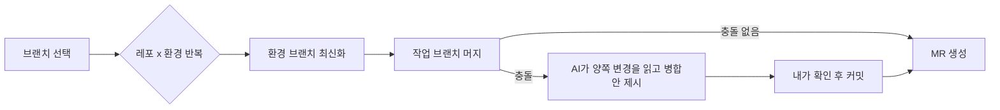
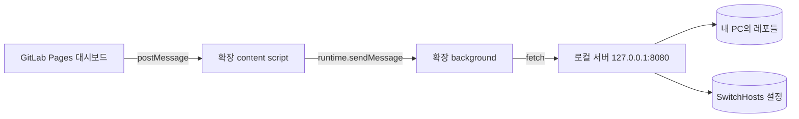

## TL;DR

- 오전에 작업을 끝내면 오후에는 쌓아 둔 불편로그 중 하나를 골라 자동화했다. 그렇게 만든 도구가 늘어나서 하나의 개발자 업무 자동화 대시보드로 모았다.
- 가장 큰 효과는 다중 레포 머지 자동화였다. 문구 하나를 고쳐도 레포 5~7개를 개발·스테이징·실QA에 각각 올려야 했는데, 이 시간이 크게 줄었다.
- 대시보드 화면은 GitLab Pages에 올리고 git 작업은 내 PC의 로컬 서버가 맡는다. 크롬이 공개 사이트에서 `127.0.0.1`로 가는 요청을 막아서, 크롬 확장 프로그램이 요청을 중계하게 바꿨다.

## 개발자 업무 자동화는 어떤 불편부터 시작하나요?

자주 반복되고, 빠뜨리면 사고가 나는 일부터 시작했다. 아이디어는 평소에 쌓아 둔 불편로그에서 나왔다. 불편한 순간마다 한 줄씩 적어 두고, 오전에 맡은 작업을 끝낸 오후에 그중 하나를 채택해 만들었다. 오전에 몰입해서 일하는 방식은 [AI로 일하니 모든 일이 딥워크가 됐다](/posts/ai-deepwork-block-schedule)에 따로 정리했다.

불편로그에서 고른 것은 세 가지였다.

| 불편 | 무엇이 문제였나 | 만든 것 |
| --- | --- | --- |
| 반복 머지 | 문구 하나를 고쳐도 레포 5~7개 × 환경 3개에 머지 요청을 만들어야 했고, 가끔 하나가 빠졌다 | 브랜치 하나를 여러 레포·환경에 한 번에 머지하는 도구 |
| 호스트 착각 | 스테이징을 뺀 환경은 hosts를 잡고 테스트하는데, 잘못 잡은 채 테스트해서 시간을 날렸다 | 지금 적용된 호스트 환경을 크게 보여주는 화면 |
| 아침 탭 정리 | 출근하면 전날 열어 둔 탭이 수십 개였다 | 열린 탭을 종류별 그룹으로 묶는 크롬 확장 |

## 레포 여러 개 머지는 어떻게 자동화했나요?

브랜치 이름 하나와 대상 레포·환경을 고르면, 로컬 서버가 레포마다 환경 브랜치로 머지하고 머지 요청(MR, Merge Request)까지 만든다. 사람이 하는 일은 브랜치를 고르고 버튼을 누르는 것뿐이다.

자동화 전에는 이 작업이 단순하지만 길었다. 고치는 일 자체는 어렵지 않았다. 문제는 개발, 스테이징, 실QA 세 환경에 레포 5~7개를 각각 올리는 것이었다. 큰 작업이면 최대 21번 머지 요청을 만들어야 했다. 손으로 반복하다 보니 어떤 레포는 특정 환경에 안 올라간 채로 지나간 적도 있었다.

자동화한 흐름은 아래와 같다.



충돌이 나면 Gemini에게 충돌 파일과 양쪽 변경 내용을 보내 병합안을 받는다. AI가 낸 병합안을 바로 올리지 않고, 내가 확인한 뒤에 커밋하도록 했다. 지금까지 충돌은 한 번 났고, 작은 수정이라 병합안을 그대로 써도 문제가 없었다. 충돌이 드물기 때문에 AI 병합의 정확도를 말할 만큼 표본이 쌓이지는 않았다.

결과적으로 머지에 쓰던 시간이 크게 줄었다. 줄어든 시간보다 큰 변화는 빠뜨리는 환경이 없어졌다는 점이다.

## 호스트를 잘못 잡고 테스트하는 실수는 어떻게 막았나요?

대시보드 첫 화면에 지금 적용된 호스트 환경 이름을 큰 글씨로 띄웠다. "개발"이면 초록, "실QA"면 주황으로 보여서 테스트 전에 한 번만 보면 된다.

처음에는 hosts 파일을 읽어서 도메인별 IP를 표로 보여줬다. 그런데 항목이 500줄이 넘어서 오히려 한눈에 들어오지 않았다. 내가 알고 싶은 건 "지금 개발이냐 실QA냐" 하나였다.

그래서 hosts 파일 대신 hosts 전환 도구인 SwitchHosts의 설정 파일을 읽었다. SwitchHosts는 프로필별로 켜짐·꺼짐 상태를 JSON으로 저장한다. 켜진 프로필 이름에 "QA"가 있으면 실QA, "개발"이 있으면 개발로 판단한다.

```python
def host_env(title):
    t = (title or "").lower()
    if "qa" in t: return "실QA"
    if "개발" in t or "dev" in t: return "개발"
    if "스테이징" in t or "stag" in t: return "스테이징"
    return None
```

두 환경이 동시에 켜져 있으면 빨간색으로 "섞여 있다"고 경고한다. 전체 hosts 목록은 별도 메뉴로 남겼고, 같은 도메인이 여러 번 등록돼 있으면 위쪽 항목만 적용된다는 점을 표시했다. 실제로 한 어드민 도메인이 IP 세 개로 등록돼 있었고, 그중 두 개는 적용되지 않고 있었다.

## 아침마다 쌓인 탭은 어떻게 정리했나요?

크롬 확장 프로그램에 단축키(`Alt+Shift+G`)를 하나 만들고, 누르면 열린 탭을 주소 규칙에 따라 탭 그룹으로 묶게 했다. 로컬 개발 서버, 코드 저장소, 문서, 메신저처럼 종류별로 나뉜다. 출근해서 단축키 한 번이면 전날 탭이 정리된다.

## 개발자 업무 자동화 대시보드는 어떤 구조인가요?

화면은 GitLab Pages에 올린 정적 페이지이고, git 작업은 내 PC에서 도는 로컬 서버가 맡는다. GitLab Pages는 정적 파일만 호스팅하기 때문에, 내 PC의 레포를 건드리는 일은 로컬에서 할 수밖에 없다.



대시보드는 왼쪽 메뉴에 기능을 하나씩 붙이는 구조로 만들었다. 메뉴 링크 하나와 화면 영역 하나를 추가하면 새 기능이 생긴다. 지금은 홈(현재 호스트 + 자주 쓰는 바로가기), 배포 자동화, 호스트, 플래너 링크가 있다.

## GitLab Pages에서 localhost API를 부르면 왜 실패하나요?

크롬이 공개 웹사이트에서 사설망 주소(`127.0.0.1` 포함)로 보내는 요청을 막기 때문이다. 특히 http로만 열리는 페이지는 보안 컨텍스트(secure context)가 아니어서 요청이 서버에 도착하기 전에 차단된다.

처음에는 서버에 CORS(Cross-Origin Resource Sharing) 허용 헤더만 추가하면 될 줄 알았다. 그런데 브라우저에서는 `TypeError: Failed to fetch`만 나왔고, 로컬 서버 로그에는 요청이 한 줄도 찍히지 않았다. 서버가 거절한 게 아니라 요청이 나가지도 못한 것이었다.

해결은 이미 쓰고 있던 크롬 확장에 중계 역할을 맡기는 것이었다. 확장 프로그램의 background는 `host_permissions`에 등록한 주소로 요청을 보낼 수 있고, 이 차단을 받지 않는다. 페이지는 `window.postMessage`로 요청을 보내고, Pages 주소에서만 동작하는 content script가 이를 background로 넘긴다.

```javascript
// pages-bridge.js (content script, 대시보드 주소에서만 실행)
window.addEventListener('message', (e) => {
  if (e.source !== window || e.origin !== location.origin || !e.data?.bridgeReq) return;
  const { bridgeReq, path, method, body } = e.data;
  if (typeof path !== 'string' || !path.startsWith('/api/')) return;
  chrome.runtime.sendMessage({ type: 'raw', path, method, body }, (res) => {
    window.postMessage({ bridgeRes: bridgeReq, status: res.status, text: res.text }, location.origin);
  });
});
```

중계 경로가 생긴 만큼 아무 페이지나 로컬 서버를 부르지 못하게 막았다. content script는 대시보드 주소에서만 실행되고, `/api/`로 시작하는 경로만 넘긴다. 로컬 서버도 `127.0.0.1`에만 열고, 허용한 출처(origin)가 아닌 POST 요청은 403으로 거절한다.

## 검토한 대안

### 1안: 대시보드에서 localhost를 직접 호출 (버림)

가장 단순했지만 위에서 설명한 크롬 차단 때문에 동작하지 않았다. https로 서빙할 수 있다면 크롬이 권한을 묻는 방식으로 풀 수도 있지만, 내 환경에서는 쓸 수 없는 방법이었다.

### 2안: 브라우저에서 GitLab API를 직접 호출 (버림)

머지와 MR 생성을 브라우저에서 GitLab API로 바로 처리하는 방식이다. 서버가 필요 없다는 장점이 있다. 하지만 내 도구는 충돌 파일을 로컬 에디터로 열고, AI 병합안을 로컬 작업 트리에서 확인하고, SwitchHosts 설정을 읽어야 했다. 모두 내 PC에서만 할 수 있는 일이라 로컬 서버를 버릴 수 없었다.

### 3안: 크롬 확장이 요청을 중계 (채택)

탭 정리 때문에 이미 확장 프로그램을 쓰고 있었기 때문에 추가로 설치할 것이 없었다. 대신 대시보드가 확장 프로그램 없이는 동작하지 않는다는 제약이 생겼다. 내 PC에서만 쓰는 개인 도구라 받아들일 수 있었다.

## 결과 / 회고

- 다중 레포 머지에 쓰던 시간이 크게 줄었고, 환경을 빠뜨리는 실수가 없어졌다.
- 호스트 환경을 큰 글씨 하나로 보여주는 것만으로 테스트 전 확인이 습관이 됐다. 정보를 많이 보여주는 것보다 답 하나를 크게 보여주는 편이 효과가 컸다.
- 따로 만든 도구를 대시보드 하나로 모으고 나니 새 자동화를 붙이는 비용이 줄었다. 다음 불편로그는 메뉴 하나로 추가하면 된다.
- 설정 파일에 API 토큰을 넣은 채 커밋했던 실수가 있었다. 저장소를 옮기면서 발견해 토큰을 `.gitignore`로 빼고 히스토리를 새로 시작했다. 개인 도구일수록 이런 실수를 하기 쉽다.

비슷하게 AI로 반복 작업을 줄인 경험은 [AI가 짠 Playwright 검수 자동화](/posts/ai-playwright-qa-automation)에도 정리했다.

## 참고

- [New permission prompt for Local Network Access - Chrome for Developers](https://developer.chrome.com/blog/local-network-access)
- [Private Network Access update - Chrome for Developers](https://developer.chrome.com/blog/private-network-access-update)
- [Message passing - Chrome Extensions](https://developer.chrome.com/docs/extensions/develop/concepts/messaging)
- [Window.postMessage() - MDN](https://developer.mozilla.org/ko/docs/Web/API/Window/postMessage)
- [GitLab Pages - GitLab Docs](https://docs.gitlab.com/user/project/pages/)
- [SwitchHosts - GitHub](https://github.com/oldj/SwitchHosts)
