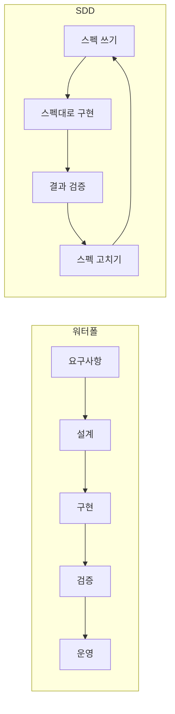

## TL;DR

- 스펙 주도 개발(Spec-Driven Development, SDD)은 "스펙 먼저"라는 점에서 워터폴과 닮았지만, 스펙을 계속 고치는 고리라는 점에서 다르다.
- 워터폴의 원조로 불리는 1970년 Royce 논문조차 한 번에 내려가는 순서는 "위험하다"고 썼다.
- 내 개인 플래너를 AI 에이전트로 만들면서, 에이전트가 낡은 스펙(CLAUDE.md)을 보고 구현하는 문제를 겪었다. 그래서 GitHub의 spec-kit으로 다음 기능을 만들어 보기로 했다.
- 중요한 건 스펙을 쓰느냐가 아니라, 쓴 스펙으로 다시 들어가느냐다.

## 스펙 주도 개발(SDD)은 워터폴의 귀환일까?

아니다. 워터폴은 스펙을 맨 위 계단에 두고 아래로 내려가며 다시 올라오지 않지만, SDD는 스펙을 쓰고 → 스펙대로 만들고 → 결과를 검증하고 → 스펙을 고치는 고리를 반복한다.

처음 SDD라는 말을 들었을 때는 나도 "스펙 문서를 먼저 다 쓰고 개발한다니, 결국 워터폴 아닌가" 싶었다. 그런데 워터폴이 실제로 무엇이었는지부터 다시 보니 질문이 달라졌다. 문제는 스펙을 먼저 쓰는 것이 아니라, 스펙이 한 번 쓰이고 낡아 가는 것이었다.



## 워터폴의 원조 논문은 정말 워터폴을 권했을까?

권하지 않았다. 워터폴의 원조로 인용되는 Winston Royce의 1970년 논문 「Managing the Development of Large Software Systems」는 요구사항 → 분석 → 설계 → 코딩 → 테스트 → 운영으로 이어지는 계단 그림을 보여 준 뒤, 이 방식이 "위험하고 실패를 부른다(risky and invites failure)"고 썼다.

Royce가 지적한 이유는 단순하다. 테스트 단계에 가서야 처음으로 실제 동작을 확인하는데, 그때 설계가 틀린 걸 알면 맨 위 계단으로 돌아가야 한다. 그래서 논문 뒷부분은 처방으로 채워져 있다. 한 번 만들어 보고 다시 만들기(do it twice), 고객을 일찍 참여시키기, 설계를 문서로 남기기 같은 것들이다. "워터폴(waterfall)"이라는 이름도 Royce가 붙인 게 아니라 나중에 다른 사람들이 그 그림에 붙인 것이다.

즉 개발 활동이 폭포처럼 한 방향으로 떨어진다는 그림은, 원래 "이렇게 하면 안 된다"는 예시에 가까웠다.

## 2001년 애자일 선언은 무엇을 바꿨나?

애자일 선언(Agile Manifesto)은 "계획을 따르기보다 변화에 대응하기"를 더 가치 있게 보겠다고 선언했다. 2001년 2월, 17명의 개발자가 모여 쓴 네 줄짜리 가치 중 하나다.

핵심은 짧게 만들고, 만들면서 배우자는 것이다. 명세는 항상 바뀔 수 있다. 정말 필요한 것은 만들어 보면서 발견하기 때문이다. 그래서 애자일 팀은 두꺼운 요구사항 문서 대신 짧은 이터레이션, 사용자 스토리, 동작하는 소프트웨어를 택했다.

그 결과 스펙은 한동안 뒷자리로 밀려났다. "문서보다 동작하는 소프트웨어"라는 문장이 "문서는 안 써도 된다"로 읽히기도 했다.

## 왜 다시 스펙이 돌아왔나?

AI 코딩 에이전트가 사람 대신 코드를 쓰기 시작했기 때문이다. 에이전트는 회의실 대화나 팀의 암묵지를 모른다. 에이전트가 보는 것은 프롬프트와 저장소 안의 문서뿐이라, 무엇을 왜 만드는지 글로 적힌 스펙이 곧 에이전트의 작업 지시서가 된다.

2025년 GitHub이 공개한 [spec-kit](https://github.com/github/spec-kit)은 이 흐름을 도구로 만든 것이다. 현재 README 기준 흐름은 이렇다.

```text
/speckit-constitution  프로젝트 원칙(코드 품질, 테스트, 보안 등) 정하기 - 프로젝트당 한 번
/speckit-specify       무엇을, 왜 만드는지 스펙 쓰기
/speckit-plan          기술 스택과 구현 계획 세우기
/speckit-tasks         계획을 작업 목록으로 쪼개기
/speckit-implement     작업대로 구현하기
/speckit-converge      구현과 스펙이 맞는지 확인하고 다시 맞추기
```

눈여겨볼 단계는 마지막 `converge`다. README는 implement와 converge를 "Converged"가 나올 때까지 반복하라고 한다. 스펙이 맨 위 계단에서 낡아 가지 않고, 구현할 때마다 다시 불려 나와 맞춰진다. 이 점이 워터폴과 가장 다른 부분이다.

## spec-first, spec-anchored, spec-as-source는 무엇이 다른가?

세 용어는 스펙이 구현 뒤에 얼마나 오래 살아남는지의 차이다. Birgitta Böckeler는 [martinfowler.com 글](https://martinfowler.com/articles/exploring-gen-ai/sdd-3-tools.html)에서 SDD를 세 단계로 나눴다.

| 단계 | 스펙의 수명 | 사람이 고치는 것 |
| --- | --- | --- |
| spec-first | 작업 하나를 위해 쓰고, 끝나면 버려도 된다 | 코드 |
| spec-anchored | 작업이 끝나도 남아서 기능을 고칠 때 다시 쓴다 | 스펙과 코드 |
| spec-as-source | 스펙이 원본이고 코드는 스펙에서 만들어진다 | 스펙만 |

워터폴과 비교하면 차이가 분명해진다. 워터폴의 스펙은 spec-first처럼 쓰이고 버려지는데, 버린 뒤에도 "계약"으로 남아 바꾸기 어렵다. SDD가 노리는 건 spec-anchored 이상이다. 스펙이 코드와 함께 계속 바뀌는 살아 있는 문서가 되는 것이다.

## 내 프로젝트에서는 어떤 문제가 있었나?

에이전트가 스펙을 보고 구현하는데, 그 스펙이 최신이 아니라서 구현이 애매해졌다.

나는 개인 플래너를 Claude Code로 만들고 있다. HTML 한 장짜리 대시보드고, 커밋 54개 대부분을 에이전트가 썼다. 에이전트가 매번 읽는 스펙은 저장소의 `CLAUDE.md` 한 파일(67줄)이다. 여기에 화면 구조, 데이터 규칙, 탭마다 무엇을 하는지가 적혀 있다. 돌아보면 이건 이미 spec-anchored를 흉내 낸 것이었다.

문제는 두 가지였다.

1. **스펙이 코드보다 늦다.** 기능을 바꾼 커밋에서 `CLAUDE.md`를 같이 고치지 않으면, 다음 세션의 에이전트는 낡은 설명을 믿고 구현한다.
2. **요구사항이 불분명하다.** "막힐 때 원하는 걸 찾아 주는 탭" 같은 요청은 내 머릿속에서도 흐릿했다. 에이전트는 흐릿한 요청도 빠르게 코드로 만들어 버리고, 나는 만든 걸 보고 나서야 원한 게 아니었다는 걸 안다.

오늘 바로 그 일이 있었다. 오전 9시 40분, 에이전트에게 "막힐 때 Claude가 물어봐 주고 오늘 할 일 하나를 골라 주는 탭"을 만들게 했다. 질문을 하나씩 던지다가 답이 4개 쌓이면 Claude가 할 일 하나를 골라 오늘 목록에 넣는 탭이었다. 요청한 대로 동작했고, 테스트도 빌드도 통과했다.

그런데 만든 걸 보니 내가 원한 게 아니었다. 같은 날 아침에 쓴 [AI 시대 개발자가 키워야 할 역량](/posts/ai-era-what-i-want) 글의 결론은 "AI가 답을 주는 게 아니라, 원하는 것을 찾고, 답을 고르고, 의심하는 건 나"였다. 그런데 1차 버전은 Claude가 답을 하나 정해 주는 탭이었다. 내가 쓴 글과 내가 시킨 기능이 서로 어긋나 있었다.

1시간 24분 뒤인 11시 4분에 탭을 다시 만들었다. Claude는 답 하나 대신 서로 다른 방향의 후보 3개를 내고, 고르는 건 내가 한다. 아니라고 생각한 후보는 "🤔 이건 아니야"를 눌러 `AI가 틀린 것:` 작업 로그로 남긴다. 바뀐 건 `17-ask-want.js` 한 파일의 48줄 추가, 19줄 삭제였다. 코드가 틀린 게 아니라 요구사항이 흐릿했던 것이고, 그 흐릿함은 동작하는 결과물을 보고 나서야 드러났다.

그래서 결국 spec-kit으로 다음 기능을 개발해 보기로 했다. `specify`에서 무엇을 왜 만드는지 먼저 정리하면 흐릿한 요구사항이 글로 드러나고, `converge`가 스펙과 코드의 차이를 매번 확인해 주기 때문이다.

돌아보면 오늘 2차 버전은 spec-kit 없이 SDD의 고리를 한 바퀴 돈 셈이다. 블로그 글이 스펙이었고(specify), 1차 버전이 구현이었고(implement), 만든 걸 글과 비교해 어긋남을 찾은 게 검증이었고(converge), 2차 버전이 스펙에 다시 맞춘 구현이었다. 다만 이 고리는 내가 우연히 글을 먼저 썼기 때문에 돌았다. 스펙이 처음부터 에이전트가 읽는 자리에 있었다면 1차 버전부터 후보 3개였을 것이다. spec-kit으로 만든 기능의 결과는 다음 글에서 정리한다.

## SDD를 할 때 아직 어려운 점은?

가볍게, 그러면서 좋은 스펙을 쓰는 것이 아직 어렵다.

- **스펙에 들어갈 게 많다.** 기능 설명만이 아니라 보안, 거버넌스, 테스트 기준 같은 것도 들어가야 한다. spec-kit은 이걸 `constitution`으로 분리했지만, 원칙을 처음 정하는 일 자체는 사람 몫이다.
- **작은 일에 무겁다.** Böckeler도 같은 글에서 작은 버그 하나에 마크다운 파일이 여러 개 생기는 걸 "호두를 깨려고 망치를 쓰는 것"에 비유했다. 개인 프로젝트에서 한 줄 고치려고 스펙 네 장을 쓰지는 않을 것이다.
- **스펙이 길어지면 읽지 않는다.** 에이전트가 만든 긴 스펙을 사람이 검토하지 않으면, 결국 검증 없는 스펙이 된다. 워터폴의 두꺼운 문서가 걸었던 길이다.

## 결과 / 회고

SDD가 워터폴로 돌아가느냐는, 스펙을 쓰느냐로 갈리지 않는다. 쓴 스펙으로 다시 들어가느냐로 갈린다. 스펙을 쓰고, 그대로 만들고, 결과를 검증하고, 스펙을 고치고, 다시 스펙을 쓰는 고리를 돌면 스펙은 계단 꼭대기에서 낡아 가지 않는다.

1970년의 Royce도, 2001년의 애자일 선언도 결국 같은 말을 했다. 정말 필요한 건 만들면서 발견한다. SDD는 그 발견을 에이전트가 읽을 수 있는 글로 남기는 방법이다.

다음 글에서는 spec-kit으로 플래너 기능 하나를 실제로 만든 과정을 정리할 생각이다. 같은 플래너에서 토큰을 줄이려고 했던 시도는 [Claude Code 토큰 줄이려고 ponytail·graphify를 써봤다](/posts/ponytail-graphify-token-review)에 있다.

## 참고

- [GitHub spec-kit](https://github.com/github/spec-kit)
- [Spec-driven development with AI: Get started with a new open source toolkit (GitHub Blog)](https://github.blog/ai-and-ml/generative-ai/spec-driven-development-with-ai-get-started-with-a-new-open-source-toolkit/)
- [Understanding Spec-Driven-Development: Kiro, spec-kit, and Tessl (Birgitta Böckeler)](https://martinfowler.com/articles/exploring-gen-ai/sdd-3-tools.html)
- [애자일 소프트웨어 개발 선언](https://agilemanifesto.org/iso/ko/manifesto.html)
- Winston W. Royce, 「Managing the Development of Large Software Systems」, Proceedings of IEEE WESCON, 1970
