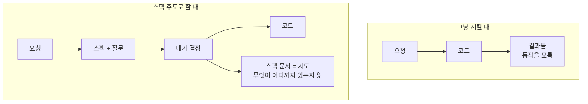
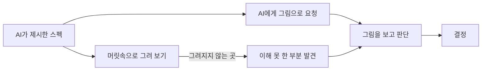

## TL;DR

- 개인 프로젝트(AI 튜터 교육 사이트)를 spec-kit으로 이틀 동안 만들었다. 스펙 6개, 태스크 147개, 커밋 38개가 나왔다.
- AI에게 그냥 시키면 결과물은 빨리 나오지만, 무엇이 어떻게 동작하는지 나는 모른다.
- 스펙 주도 개발(Spec-Driven Development, SDD)을 하면 AI가 결정할 것을 나에게 묻고, 결과가 스펙 문서로 남는다. 스펙은 지금 무엇이 어디까지 만들어졌는지 보여주는 지도가 된다.
- 앞으로 개발자에게 중요한 것은 코딩 실력이 아니라 스펙을 읽고 결정하는 안목이라고 생각한다. 그 안목을 어떻게 기를지는 아직 모르겠다.

## 스펙 주도 개발(SDD)이란 무엇이고, 왜 앞으로의 개발 방식이라고 보나요?

스펙 주도 개발은 코드보다 스펙(무엇을, 왜 만드는가)을 먼저 쓰고, 그 스펙에서 계획·태스크·코드를 차례로 만들어 내는 방식이다. 나는 AI로 개발하는 시대에 개발자가 일하는 방식이 이쪽으로 갈 거라고 본다. 희미하지만 나름의 방향을 찾은 느낌이다.

이번에 쓴 도구는 GitHub의 [spec-kit](https://github.com/github/spec-kit)이다. 흐름은 아래와 같다.

먼저 프로젝트 원칙(constitution)을 정한다. 이번 프로젝트에는 "정답 대신 질문", "한 번에 한 개념, 한국어로", "단순함이 기본값" 같은 원칙 5개를 두었다. 그다음 기능마다 스펙을 쓰고, AI가 스펙의 빈 곳을 질문하면 내가 답하고, 계획과 태스크를 거쳐 구현한다.

이틀 동안 나온 결과는 이렇다.

| 항목 | 수 |
| --- | --- |
| 기능 스펙 | 6개 (강의 복습 튜터, 강좌 목록, 강좌 관리, 강의 편집, 백지 복습, 강의 채팅) |
| 태스크 | 147개 |
| AI가 물어본 명확화 질문 | 11개 |
| 커밋 | 38개 |

## AI에게 그냥 시키면 무엇이 문제인가요?

AI에게 그냥 시키면 어느 순간 뚝딱 만들어져 있다. 그런데 내가 짠 코드가 아니라서 어떤 동작이 있는지, 어떻게 구현되어 있는지 모른다.

이전에 [AI와 코딩 대결에서 20줄짜리 내 코드가 진 이유](/posts/ai-coding-battle-muted-autoplay)를 쓰면서도 느꼈지만, 이제 AI보다 코드를 잘 짠다는 말은 어불성설이다. 문제는 속도가 아니라 이해다. 만들어진 것을 이해하지 못하면, 그다음 결정도 내가 할 수 없다.

## 스펙 주도 개발을 하면 무엇이 달라지나요?

스펙 주도 개발을 하면 AI가 결정해야 할 것을 계속 나에게 묻는다. 그리고 그 답이 스펙 문서에 남는다. 실제로 받은 질문 몇 개를 옮긴다.

- Q: 강의는 정해진 순서대로만 들을 수 있는가? → A: 자유 선택(복습만 해당 강의 완료 후 열림)
- Q: 학생은 어떤 방식으로 답하는가? → A: 문제마다 객관식/단답형/서술형 지정, 서술형은 AI가 기준으로 판정
- Q: 운영자는 어떤 방식으로 로그인하는가? → A: 공유 비밀번호 하나, 로그인 최대 하루 유지
- Q: 강좌 변경은 바꿀 때마다 반영되는가, 저장 버튼으로 한꺼번에 반영되는가? → A: "저장"을 누를 때 한꺼번에 반영, 저장 안 한 채 떠나면 경고

이 질문들은 코드 질문이 아니다. 서비스 정책 질문이다. 그리고 그 도메인을 잘 모르는 나 자신이 병목이었다. 결국 AI가 추천한 답 위주로 고르게 되었고, 그렇게 고르면 구현 세부는 여전히 모른다.

그래도 차이는 있다. 스펙을 읽으면 어떤 동작이 있고 어디까지 개발되어 있는지 알 수 있다. 코드는 몰라도 서비스는 안다. 스펙은 지도 같은 것이다.

## 개발자에게 이제 가장 중요한 능력은 무엇인가요?

나는 진행되는 모든 상황에서 결정할 수 있는 안목이라고 생각한다. AI가 어떤 스펙을 짰고 왜 그런 스펙이 되었는지 내가 충분히 이해하지 못하면 안 된다. 이해해야 고를 수 있고, 골라야 책임질 수 있다.

개발자는 이미 개발만 하지 않는다. 디자인도 하고 설계도 한다. 이제 AI를 누가 더 잘 쓰느냐의 문제는, 스펙 주도 개발을 누가 더 잘하느냐의 문제로 바뀐다고 본다.

## 좋은 스펙은 개발자, 기획자, 디자이너 중 누가 만드나요?

솔직히 아직 모르겠다. spec-kit은 개발자든 기획자든 디자이너든 누구나 쓸 수 있다. 그러면 좋은 스펙은 누가 만들까?

내 짐작은 직군보다 서비스를 얼마나 깊이 아느냐가 중요하다는 것이다. 특정 도메인에 오래 있었던 개발자는 더 좋은 정책을 알 것 같다. 물론 그게 꼭 개발자일 필요는 없다. 서비스의 한계부터 장점까지 전부 아는 사람이 좋은 스펙을 쓴다.

그래서 개발자, 디자이너, 기획자의 경계는 점점 흐려지고, 한 사람이 스펙부터 출시까지 다 하는 방향으로 갈 것 같다.

## 그 안목은 어떻게 기를 수 있을까?

이 질문에 정답은 아직 없다. 이번에 실제로 해 본 방법은 두 가지다.

처음에는 AI가 먼저 제시한 스펙을 이해하려고 노력하며 머릿속으로 그려 보았다. 이 화면에서 무엇을 누르면 어디로 가는지, 이 정책이 학생에게는 어떻게 보이는지를 떠올리면서 읽었다. 그려지지 않는 부분이 곧 내가 이해하지 못한 부분이었다.

나중에는 AI에게 스펙을 이미지로 그려 달라고 했다. 글로 된 스펙보다 그림이 훨씬 빨리 읽혔고, 흐름이 어색한 곳이나 빠진 경우가 눈에 들어왔다. 머릿속으로 그리던 일을 AI에게 맡기고, 나는 그 그림을 보고 판단하는 데 집중할 수 있었다.

결국 안목은 스펙을 "읽는" 것이 아니라 "그려 보는" 데서 시작하는 것 같다.

## 회고

AI로 개발하면 결과물은 빨리 나오지만, 나는 점점 내 서비스를 모르는 사람이 된다. 스펙 주도 개발은 그 간격을 스펙이라는 지도로 메워 준다. 다만 지도를 그리는 결정은 여전히 사람의 몫이고, 그 결정의 질이 앞으로의 실력이 될 것 같다.

그때가 언제, 어떻게 올지는 모르겠다. 그래도 준비해야겠다.

관련 글: [도서 '먼저 온 미래' 회고 - AI 시대의 생존법과 지식 구조화 전략](/posts/book_먼저온_미래)

## 참고

- [github/spec-kit](https://github.com/github/spec-kit)
- [Spec-driven development with AI (GitHub Blog)](https://github.blog/ai-and-ml/generative-ai/spec-driven-development-with-ai-get-started-with-a-new-open-source-toolkit/)
